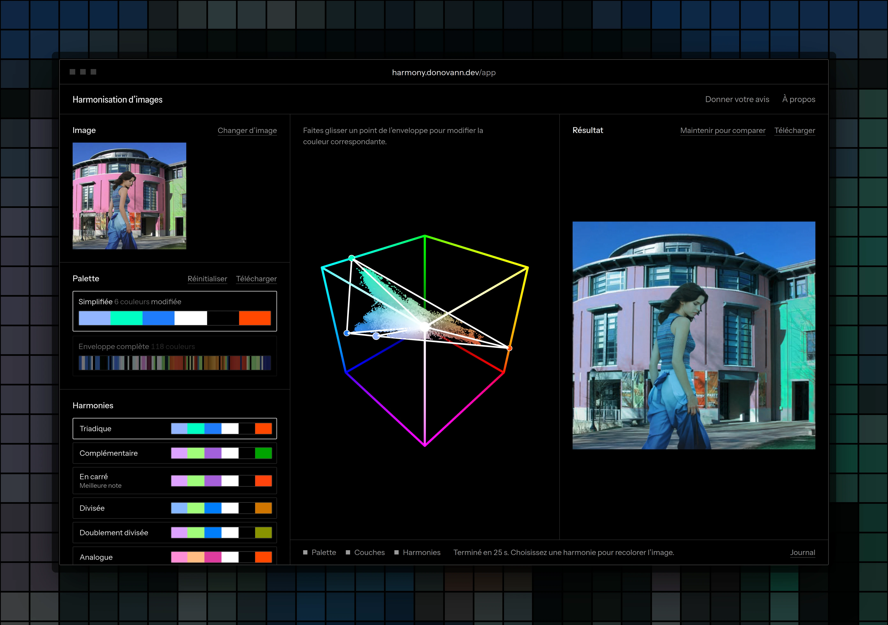

# Harmonisation d’images

Extraction de palette, décomposition en couches et recoloration d’images selon une harmonie de couleurs.
Implémentation de l’article de Tan, Echevarria et Gingold (2018), [_Palette-based image decomposition, harmonization, and color transfer_](https://arxiv.org/abs/1804.01225).



Démo en ligne : [harmony.donovann.dev](https://harmony.donovann.dev)

## Fonctionnement

1. **Palette** : l’enveloppe convexe des couleurs de l’image est simplifiée jusqu’à une palette de quelques couleurs, tant que l’erreur de reconstruction reste sous 2/255.
2. **Couches** : l’image est décomposée en une couche par couleur de la palette, dans l’espace RGBXY (couleur et position), ce qui garde des couches spatialement cohérentes.
3. **Recoloration** : des palettes harmonisées sont proposées (complémentaire, triadique, en carré…), et chaque couleur peut aussi être déplacée à la main dans l’espace RGB. L’image est recomposée en direct.

## Lancer en local

Le projet est testé avec Python 3.12, la version utilisée par l’image Docker.

```bash
git clone https://github.com/J-hune/harmony.git
cd harmony
python3.12 -m venv .venv
source .venv/bin/activate
pip install -r requirements.txt
python main.py
```

L’application est accessible sur [127.0.0.1:5000](http://127.0.0.1:5000).

## Configuration

Les réglages se font par variables d’environnement. `main.py` ne lit pas le fichier `.env` lui-même : en local, chargez-le dans le shell avant de lancer l’application.

```bash
cp .env.example .env
set -a; source .env; set +a
python main.py
```

| Variable               | Rôle (valeur par défaut)                                         |
| ---------------------- | ---------------------------------------------------------------- |
| `HOST`                 | Adresse d’écoute (`127.0.0.1`, ou `0.0.0.0` dans un conteneur)   |
| `PORT`                 | Port unique : pages et WebSocket (`5000`)                        |
| `MAX_CONCURRENT_JOBS`  | Calculs d’images simultanés ; les suivants attendent dans une file (`1`) |
| `MAX_QUEUE_LENGTH`     | Personnes en attente au maximum, au-delà la demande est refusée (`5`) |
| `MAX_IMAGE_PIXELS`     | Taille maximale d’une image ; au-delà elle est refusée (`2000000`) |
| `CORS_ALLOWED_ORIGINS` | Origines autorisées pour le WebSocket, séparées par des virgules (par défaut, seulement l’adresse du site) |
| `APP_SECRET_KEY`       | Secret Flask, obligatoire en production                          |

La liste complète se trouve dans `.env.example`.

## Docker

```bash
cp .env.example .env
docker compose up -d --build
```

Docker Compose lit `.env` : le conteneur écoute sur `PORT` et le publie sur ce même port. Derrière un proxy, il suffit d’y rediriger tout le trafic, y compris le WebSocket sur `/socket.io/`.
